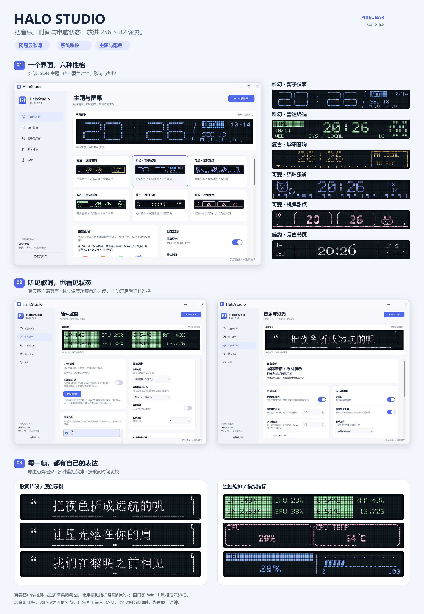

# HaloStudio · PixelBar DIY

> [!WARNING]
> **非官方实验项目 · 设备损坏与变砖风险**
> 本项目主要代码由 **GPT-6 Astra** 完成，结合作者在本机设备上的实验与反馈迭代。项目**尚未经过完整、全面的测试，不保证不会损坏设备**，也不保证适用于所有硬件批次、固件或播放器版本。固件/硬件版本不匹配、刷写中断及其他未知问题，可能导致音响无法启动、显示异常、变砖或其他设备损坏。已提供的备份与回退流程不是通用救砖保证，显示 MCU 完全失效后的独立 USB 恢复尚未验证。请先阅读适配条件、备份和恢复边界，自行评估并承担使用风险。遇到问题欢迎通过 [GitHub Issues](https://github.com/woozyc/pixelbardiy/issues) 反馈，附版本和复现步骤，并隐藏设备序列号、路径和个人信息。

将 Edifier Halo PixelBar 的 **256 × 32 点阵屏**变成桌面的延伸：看网易云歌词、电脑性能状态，也能选择自己喜欢的时钟、图案与配色。当前桌面版是 **C# / .NET 10 的 HaloStudio 2.6.3**，Python 旧版源码保留在独立目录。

## 当前功能

**网易云歌词同步 + 电脑性能监控 + 自定义主题与颜色**，共用全像素显示和 MCU 本地过场。正常退出或心跳超时后释放屏幕，恢复原厂时钟，再交由官方软件控制。

- **网易云电脑端歌词显示：** 已适配版本可以关闭桌面歌词、离开歌词页并最小化播放；支持 YRC 逐字／逐词时间分页、普通 LRC 首尾两页、缓存和本地导入，默认提前 0.8 秒，可独立调整偏移。[歌词说明](halo-studio-dotnet/docs/LYRICS.md)
- **电脑性能指标监控：** CPU、内存、网络、磁盘、显卡及可用的温度／风扇传感器；支持仪表、负载条、曲线、紧凑两行、双卡片及轮换。参考并感谢 [TrafficMonitor](https://github.com/zhongyang219/TrafficMonitor) 的监控设计与开源实现，温度采集参考其采用的 LibreHardwareMonitor 路径适配；HaloStudio 可以独立运行，**无需先启动 TrafficMonitor**。
- **主题风格与颜色自定义：** 六套外部 JSON 主题统一覆盖时钟、监控、歌词，支持添加主题、更改布局／字体／图案／过场；内置主题快捷色、校准色和 30 个 TempoHub 官方预设色，逐主题保存选择。
- **退出／崩溃后恢复默认显示：** 正常退出主动释放独占；程序崩溃或停止心跳后由 MCU 租约超时回收，恢复原厂时钟。本机已验证退出与停心跳恢复。
- **保留官方默认功能：** 原厂功能路径保留，释放控制后可继续使用 TempoHub；已实测时钟、中文主题、音乐播放、静态灯光、亮度和自创文字正常。官方全部功能尚未逐项验证，详见下方记录。
- **绿色便携、项目代码开源：** 解压运行，主程序无需管理员权限；日常显示只写 RAM，不擦写 Flash。独立温度采集首次默认关闭，主动启用后才记住选择并按需请求授权。项目原创代码公开，固件 BIN 中原厂专有部分的许可另计；不承诺零风险。

[](docs/images/halostudio-overview.png)

上图来自真实客户端控件和主题渲染器，使用模拟指标及原创歌词；窗口配 Win11 风格展示边框。非音响实拍，颜色是近似预览。[效果图生成方法](docs/SCREENSHOTS.md)

画面通过 USB HID 写入显示 MCU RAM，按需压缩和差分传输；上推、揭幕、中心展开、像素溶解和字符雨在 MCU 本地执行。换主题与演示换幕保持同一显示租约，不插入原厂时钟，也没有原厂图片上传提示。后台减少 UI 绘制、按需采样并合并待传帧，避免积压。

## 不足与限制

- **功能少于官方软件：** 尚未提供 TempoHub 的天气／资讯、官方在线内容库及完整素材编辑管理体验；当前重点是歌词、监控和自定义像素主题。
- **PC 不能高帧率推送任意画面：** USB 主控到显示 MCU 的串口转发、分包和确认存在延迟，USB 连接本身不代表能以视频帧率刷新整屏；复杂动态不能靠电脑逐帧发送解决。
- **流畅过场依赖自定义 MCU 固件：** 应用包不能单独让原厂固件获得全部直绘／动画能力；刷写有风险，且本地动画是已实现的有限几种效果。
- **主题仍需打磨：** 部分布局、装饰及字形不够美观，超长文本和极小字号受 256 × 32 分辨率约束。
- **颜色不完全准确：** 屏幕是整屏共色点阵，并非每个像素独立 RGB；预览和面板存在色差，目视校准只在本机核对，官方色也未逐个实屏验证。
- **歌词适配有边界：** 网易云版本和接口变化可能影响同步，部分歌曲没有歌词或逐字时间；离线无缓存时无法显示未知歌词，极短句还受传输延迟限制。
- **硬件覆盖有限：** 只在文末所列 Windows、音响和播放器环境测试；独立 CPU 温度目前面向部分 AMD 平台，缺少驱动／传感器的指标显示 `--`，不保证所有风扇都有转速。

## 下载与启动

| 内容 | 下载 / 说明 |
| --- | --- |
| 最新 Windows x64 应用与固件资料 | [HaloStudio C# 2.6.3](packages/HaloStudio-CSharp-2.6.3-win64.zip) |
| MCU 固件与工程工具包 | [HPL2 固件工具包 2.6.0](packages/HaloPixelBar-MCU-2.6.0.zip) |
| 下载校验 | [全部包的 SHA256](packages/SHA256SUMS.txt) |
| C# 使用、配置与构建 | [新版说明](halo-studio-dotnet/README.md) |
| Python 旧版 | [旧版说明和下载](legacy-python/README.md) |

1. 完整解压 ZIP，运行其中 `HaloStudioNet/HaloStudioNet.exe`。包含 .NET 运行时，无需安装 Python 或 .NET；保留所有资源和依赖文件。
2. 正常退出 TempoHub 或其他显示控制程序。导入**本机已完成实屏验证**的 MCU 安装记录，客户端按固件哈希启用对应能力；分发包不含个人设备记录。首次使用可先运行 `HaloStudioNet.exe --preview` 离线查看。
3. 在“主题与屏幕”选择默认时钟或监控，播放网易云音乐时可自动显示歌词。在“设置”开启登录 Windows 后后台启动。
4. 独立 CPU 温度采集首次默认关闭；需要时在“硬件监控”主动开启或点击“授权并重试”。开启后记住选择，下次启动自动恢复，驱动要求权限时可能再次弹出 UAC；关闭开关即可取消下次自动启用。
5. 关闭窗口会隐藏到托盘；“设置 → 退出并恢复原厂显示”才会停止显示控制。旧版本入口在“设置 → HaloStudio”内，切换前先释放显示权；未自动找到旧版时可手动选择 EXE。

本机设置、歌词缓存、安装身份、运行日志都保存在 `runtime/`，不纳入 Git 或分发包。不要复制其他人的安装记录来绕过设备验证。

## 官方 TempoHub 兼容性实测

2026-10-14 使用 **EDIFIER TempoHub 1.3.0**、Windows 11 26H2（26300.9457）、网易云 **3.1.41.205564** 测试当前换色 MCU（SHA `9a1b6d…237e`）。HaloStudio 2.6.0 正常退出后，官方软件识别设备并报告 1.3.7；用户已确认**原厂双箭头时钟走秒、中文“吉时 已到”主题、音乐播放、绿色静光、低亮度调节和自创文字显示正常**。

**官方情绪歌词尚未完成验证**：登录 TempoHub 后仍提示需绑定音乐账号，本轮未继续绑定，不能据此判定固件不兼容。自创文字由用户手动测试，尚未覆盖所有排列和动画组合。

这是单台设备上的有限功能测试，不表示官方全部功能、所有版本或恢复能力都已验证。完整操作、证据与未测范围见 [官方兼容性记录](docs/TEMPOHUB_COMPATIBILITY.md)。测试没有再次刷写固件，官方控制器与 HaloStudio 分开运行。

## 实现文档

从 [文档索引](docs/README.md) 开始：涵盖 [实时 USB 像素协议](docs/USB_PIXEL_PROTOCOL.md)、[MCU 本地动画](docs/MCU_ANIMATION.md)及 [固件与恢复边界](docs/FIRMWARE.md)。

## 固件与恢复边界

当前换色与过场镜像为 [mcu-hpl2-color.bin](halo-studio-dotnet/firmware-color/mcu-hpl2-color.bin)，57,252 字节：

```text
9a1b6d1425e980ca1bf9753e0dc1c7ef5ffefde95c741c9a6cf797ace5da237e
```

它只修改显示 MCU 的应用区域，不包含 USB/音频主控或引导区。已经安装并验证相同固件的设备无需再刷。客户端不会自动升级固件。

[换色固件说明](halo-studio-dotnet/firmware-color/README.md)包含协议、源码、离线报告、升级脚本及限制。`stage_color.py` 是保留的工程工具，需要完整的本机备份、原厂包和身份记录；默认仅预检，显式参数才允许发送，不自动重试。它不是解压即可用于任意设备的通用刷机工具。旧 `HaloFirmware v1.0.0` 更新器仍固定旧 codec 镜像，不能用它刷新的换色镜像。

全屏动画和字符雨的历史源码、镜像及报告也保留在新版目录。回退依赖显示 MCU 应用仍可响应；不能将这些文件当作已经验证的独立救砖方案。

## 已测试环境与必要依赖

| 项目 | 实际测试版本 / 前提 |
| --- | --- |
| Windows | **Windows 11 专业版，64 位，26H2，OS Build 26300.9457**；这是本机测试环境，不代表所有 Windows 版本已验证 |
| 网易云音乐 | **Windows 桌面版 3.1.41.205564**；独立播放进度只对已核对模块指纹启用，更新播放器后可能需要重新适配 |
| 音响 | Edifier Halo PixelBar，USB `VID 2D99 / PID A106`、`MI04`、主控报告 `1.3.7`；还需核对硬件及显示 MCU 镜像，不能只凭产品名判断兼容 |
| 日常运行 | Windows x64 应用包已含 **.NET 10** 运行时；无需 Python、.NET SDK 或 TrafficMonitor。USB HID 使用系统驱动；需自己的、实屏验证过的 MCU 安装记录 |
| 在线歌词 | 需能访问歌词接口；网易云歌曲 ID 与歌词版本应匹配。不要求开启桌面歌词。离线仅使用缓存或导入的 LRC，部分歌曲没有逐字数据 |
| CPU 温度（可选） | 随包 HaloThermal / AMD 采集模块；复用已有 WinRing0/PawnIO，否则通过已校验的 PawnIO 组件加载。可能需要用户确认 UAC。独立通道面向 AMD Family 17h / 19h / 1Ah，其他硬件可能没有温度 |
| GPU / 主板监控（可选） | NVIDIA 指标需厂商驱动提供 NVML；主板其他传感器需可用的 LHM/OHM WMI 提供程序。缺少传感器不影响时钟/歌词，显示 `--` |
| C# 源码编译 | Windows x64 + **.NET 10 SDK**（本机构建 10.0.401）；首次还原需网络。目标 API 版本为 Windows 10.0.19041，不能据此宣称旧系统已完整测试 |
| 固件工程工具 | **Python 3.12 x64**、`legacy-python/requirements-dev.txt` 固定依赖（含 Unicorn 2.1.3、Keystone 0.9.2、Capstone 5.0.9、hidapi、PySide6、psutil）；另需自己的原厂包、镜像和备份记录，详见[完整命令流程](docs/FIRMWARE_USAGE.md) |

应用包为 **2.6.3**，固件工具包仍为 **2.6.0** 发布资料；显示 MCU BIN 与 2.5.1 相同，已安装并验证相同 SHA 的设备**无需重新刷写**。本次歌词兼容性修复只需更新电脑端。

## 源码与验证

```text
halo-studio-dotnet/   C# 2.6.3 客户端、外部主题/色表、MCU 扩展源码与报告
legacy-python/       Python 旧版、依赖、测试与固件实验基线
docs/                MCU 动画、USB 协议与显示链路的实现原理
firmware/            当前与历史显示 MCU 镜像、校验值
packages/            可下载的应用包、历史包与哈希
```

在 Windows 上安装 .NET 10 SDK，然后：

```powershell
cd halo-studio-dotnet
./scripts/build.ps1
./scripts/verify.ps1
```

GitHub Actions 分别验证 Python 与 C#。2.6.2 本机通过 397 项离线检查，覆盖首次温度采集关闭、主动启用／关闭持久化、旧设置迁移以及原有协议／歌词／配色回归；布局验证见[验证记录](halo-studio-dotnet/docs/VALIDATION.md)。新 MCU 的实屏、退出、停心跳恢复已在此前单独验证，本次没有刷写固件。离线检查不替代刷机后的实物确认。

固件离线重建需要自行取得并核对原厂显示 MCU 镜像。先依照 [旧固件构建说明](legacy-python/docs/FIRMWARE.md)准备 `legacy-python/firmware-analysis/v137/mcu.bin`，安装 `legacy-python/requirements-dev.txt` 中的开发依赖，再运行 `python halo-studio-dotnet/firmware-color/validate_color.py`。`legacy-python/` 中的 Python/实验工具同时为新版验证提供基线；仿真不访问 USB，也不在 CI 中自动刷写设备。

## 致谢与许可

项目原创代码采用 [MIT](LICENSE)。温度组件、PawnIO 和参考实现遵循各自许可，详见 [第三方声明](THIRD_PARTY_LICENSE.txt)及[新版声明](halo-studio-dotnet/THIRD_PARTY_LICENSE.txt)。固件 BIN 含原厂专有代码，不因本项目的 MIT 许可而变成 MIT 软件。

感谢 [TrafficMonitor](https://github.com/zhongyang219/TrafficMonitor)、[LibreHardwareMonitor](https://github.com/LibreHardwareMonitor/LibreHardwareMonitor)、[PawnIO](https://github.com/namazso/PawnIO) 的开源工作，以及提供实机反馈的使用者。界面布局参考 [Clash Verge Rev](https://github.com/clash-verge-rev/clash-verge-rev)。
