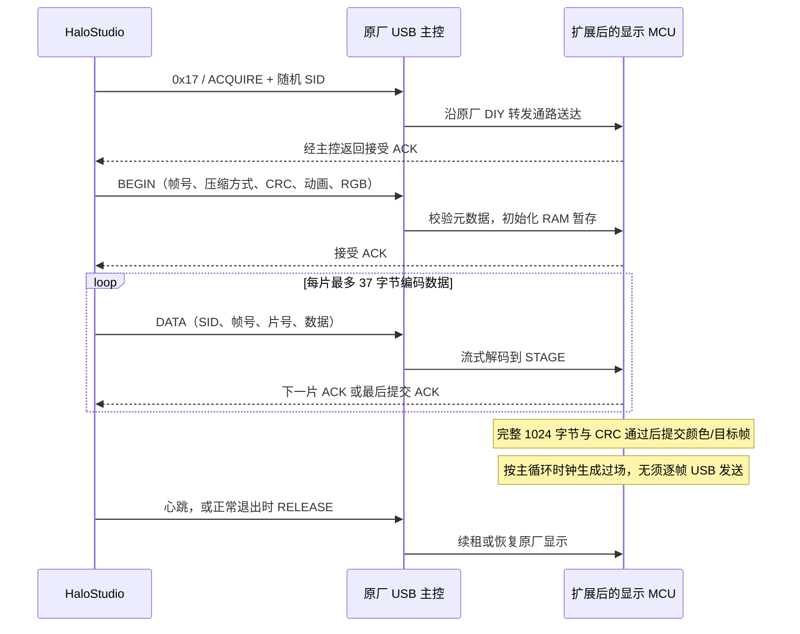

# 实时 USB 像素画面如何传输

## 1. 为什么不能连续上传原厂图片

原厂图片上传用于保存图像资源。显示 MCU 的 DIY START/DATA/END 路径会更改上传状态、写外部 SPI Flash 和图像元数据，所以每句歌词都上传图片会出现“图片上传中”，也会反复擦写存储。

HPL2 复用原厂 USB 到显示 MCU 的转发通路，但在显示 MCU 上增加严格识别的 RAM 分流。只有匹配 HPL2 标识、操作和会话的数据才走新处理器；日常帧不落入资源擦写路径。USB/音频主控代码不需要修改。这不是探测未知原厂流式接口后直接调用，而是已经安装的显示 MCU 扩展提供的新接口。



## 2. 一帧只有 1024 字节

256 × 32 = 8192 个开关像素，采用 1 bit/pixel，共 1024 字节。按照每 8 行一个页组织：

```text
index = (y / 8) * 256 + x     // 整数除法
mask  = 1 << (y % 8)
pixel = (frame[index] & mask) != 0
```

一个字节对应同一列上的 8 个垂直像素；不是横向连续 8 点。PC 上的字体、图形和监控指标最终全部栅格化成这个掩码。亮起像素共用一个 RGB，颜色随帧元数据传送，不占用每个像素的三个字节。

## 3. HID 外壳与 HPL2 载荷

[Protocol.cs](../halo-studio-dotnet/src/HaloStudio/Protocol.cs)定义完整格式。HID 输出为 64 字节：

| 偏移 | 长度 | 意义 |
| --- | --- | --- |
| 0 | 1 | `2E` |
| 1 | 1 | `AA` |
| 2 | 1 | 命令类型；常规显示命令为 `ED` |
| 3 | 1 | 命令号；HPL2 为 `17` |
| 4 | 2 | 载荷长度，大端，最大 57 |
| 6 | 可变 | 载荷 |
| 6 + 长度 | 1 | 从偏移 1 到载荷结尾的字节和，取低 8 位 |
| 后续 | 可变 | 补零至 64 字节 |

返回帧以 `2F BB EC` 开始，客户端还检查命令号、长度和字节和。这个简单校验只用于外层传输，不能替代点阵 CRC。

HPL2 载荷格式：

| 载荷偏移 | 长度 | 意义 |
| --- | --- | --- |
| 0 | 4 | `00 02 FF FF` 分流前缀 |
| 4 | 4 | ASCII `HPL2` |
| 8 | 1 | 操作码 |
| 9 | 4 | 非零会话 SID，大端 |
| 13 | 2 | 帧号，大端 |
| 15 | 1 | 分片序号 |
| 16 | 1 | 本片数据长度 |
| 17 | 0–37 | 本片数据 |

操作码 1/2/5 为接管、心跳和释放；3/4 保留旧原始帧协议；6/7 为扩展 BEGIN/DATA。每个 DATA 最多 37 字节，这是本协议的上限，并不意味着 HID 剩余所有字节都可直接拿来用。SID 用于所有权隔离，不是加密或身份认证。

## 4. 压缩、差分与提交

扩展 BEGIN 的 12 字节元数据如下；支持帧内换色的固件接受精确 15 字节格式，在末尾追加 RGB。

| 元数据偏移 | 长度 | 含义 |
| --- | --- | --- |
| 0 | 1 | codec：0 原始 / 1 RLE / 2 XOR-RLE |
| 1 | 1 | 动画编号 |
| 2 | 1 | 动画步长间隔，8–64 ms |
| 3 | 1 | 保留，发送 0 |
| 4 | 2 | 编码后的数据长度 |
| 6 | 2 | 差分基准帧号 |
| 8 | 2 | 差分基准 CRC |
| 10 | 2 | 最终解码点阵 CRC |
| 12 | 3 | 可选 R、G、B；只在已验证换色固件上发送 |

多字节数值均为大端。CRC 使用多项式 `0x1021`，初始值 0，无反射、无最终异或，覆盖完整 1024 字节掩码。

PC 同时计算三个候选，选编码字节数最少的方案：原始点阵；点阵 RLE；与最后确认帧异或后再 RLE。RLE 的控制字低 7 位加一表示长度 1–128，高位 1 表示重复后续一个字节，高位 0 表示复制后续对应长度的字面量。MCU 的解码状态可跨分片保留，且每次输出都限制在暂存缓冲区内。

差分只有在基准帧号和 CRC 都匹配时才可接受。未收完、校验失败或被新歌词替代的帧，绝不能成为下一帧的差分基准。每 64 个发送帧号强制采用不依赖旧帧的候选，避免一直依赖长差分链。

普通中间 ACK 载荷为 `00 03 FF FF`，最后提交/释放 ACK 为 `00 05`。客户端逐片等待确认，一次只保留一个请求等待者。全原始帧约需 `1 + ceil(1024/37) = 29` 个 USB 请求；文字或局部数值变化通常明显更少，但包数由实际图案决定。ACK 表示目标通过校验并被接受，不表示过场已全部播放完。

## 5. 如何避免半帧、歌词积压与闪回时钟

- DATA 解码到 STAGE，显示缓冲不逐片改动。收齐 1024 字节并通过目标 CRC 后才允许发布或启动动画。
- PC 的待发目标只保留最新一帧。高优先级歌词可在当前分片 ACK 后放弃尚未提交的旧目标，下一 BEGIN 重新初始化暂存；已确认基准仍保留。
- 新固件将 RGB 随帧校验提交，换主题不再 RELEASE → 原厂 EF → ACQUIRE，所以不插入原厂时钟。同一幅点阵仅颜色改变也会提交一帧。
- 最新固件帧号 65535 后接续 1，无需释放会话；旧固件保留原兼容行为。
- [Hid.cs](../halo-studio-dotnet/src/HaloStudio/Hid.cs)分别使用无缓冲异步读/写句柄，避免阻塞读占住写锁；请求超时 1.5 秒，输入队列有界。

PC 保存完整目标和动画参数，并等待本地动画的名义时间后发送下一普通场景。**传目标帧的速率与 MCU 过场中间帧速率是两回事**；这条通路不是 60 fps 全彩视频接口。当前收益来自压缩、差分与减少中间帧传输，不能用 USB 理论带宽直接推算实屏刷新率。

核心代码：[PC 传输调度](../halo-studio-dotnet/src/HaloStudio/RamController.cs)、[MCU 解码与提交](../halo-studio-dotnet/firmware-color/codec_color_thumb.s)、[离线协议基准](../halo-studio-dotnet/tests/codec-vectors.json)。
